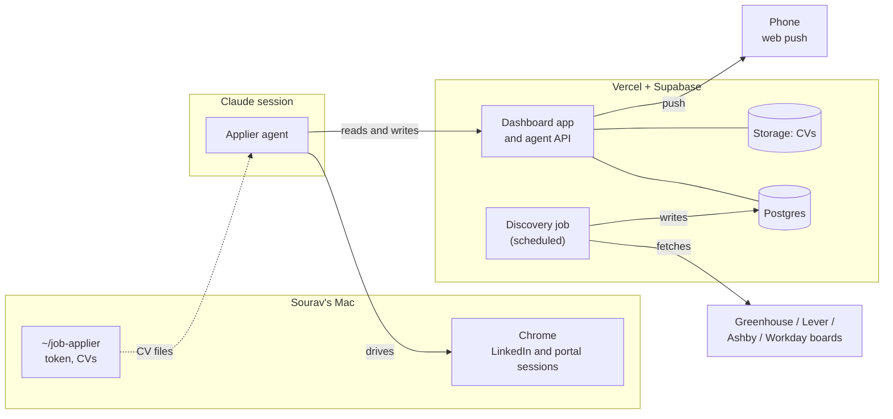
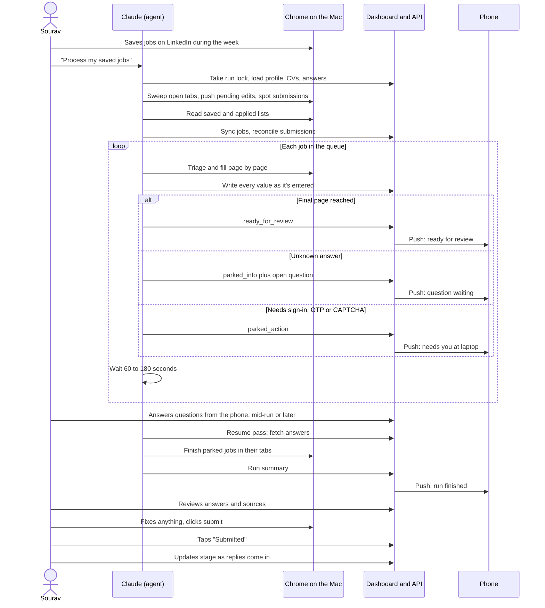
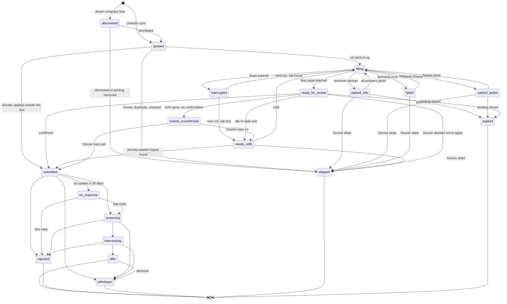
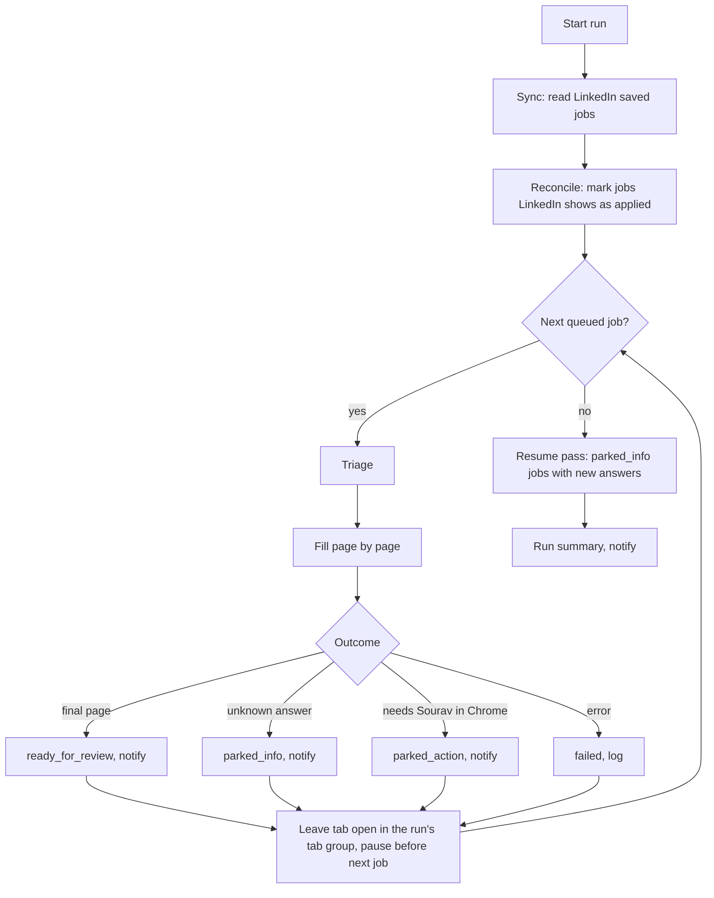

# Job Applier: Product Spec

| | |
|---|---|
| Owner | Sourav Sarkar |
| Status | Draft v0.3.1, for review. v0.3.1 adds the CV rules, run cadence, daily cap and compensation policy. v0.3 closed the gaps found in the flow check (`docs/test-cases.md`) and adds the end-to-end walkthrough and setup checklist |
| Last updated | 8 November 2026 |
| Repo | `souravsarkar1295/job-applier-claude` (private) |

## 1. Problem

Applying to a product role takes 15 to 40 minutes, and most of that time goes on retyping the same facts and answering the same questions on a different portal. The decision that matters (is this job worth applying to?) takes a minute. This product keeps that decision with Sourav and takes over the repetitive part: filling the forms, reusing approved answers, drafting new ones, and tracking every application to an outcome.

### Goals

1. Every job Sourav saves on LinkedIn gets filled up to the final review page without him typing anything he has already answered once.
2. Openings at a chosen list of target companies are found automatically and shown to him for a yes or no decision.
3. Nothing is submitted without his review.
4. Anything the system does not know is asked once, answered once, and reused afterwards.
5. One dashboard shows the state of every application, from saved to offer or rejection.

### Non-goals for now

Auto-submit, applying without Sourav's laptop and Chrome, online assessments and video interviews, reading his email, and searching LinkedIn on his behalf. Sourav curates LinkedIn saved jobs himself so unwanted jobs never land there.

## 2. Decisions so far

| Area | Decision |
|---|---|
| Where applying runs | Claude drives Sourav's own Chrome (Claude in Chrome extension), started on demand from a Claude chat |
| v1 scope | LinkedIn saved jobs only: Easy Apply and the external apply button. Dream-company flow follows in a later milestone |
| Submit policy | Always stop before submit. Sourav reviews and submits. Auto-submit may be revisited later |
| Unknown answers | Flagged and left open, never guessed |
| Pauses | Go to the dashboard. Notified on the dashboard and by phone push. No email |
| Batch behaviour | A run processes the whole saved list, up to the daily cap. Parked jobs don't stop the run |
| Run cadence | Sourav starts one or two runs a day |
| Daily cap | 20 LinkedIn applications a day across all runs. The rest wait for the next day |
| Tab policy | A filled form stays open in its tab until it is submitted. Refilling from stored values is only for recovery |
| Dashboard | Interactive web app, not a spreadsheet. Tracker plus review queue |
| Hosting | Self-hosted: Next.js on Vercel, Supabase (Postgres, Auth, Storage) |
| Code | Private GitHub repo. Personal data is never committed |
| Portability | Code and docs can be developed from any tool. Running the applier needs Claude |

## 3. System overview



| Component | Responsibility | Runs on | Started by |
|---|---|---|---|
| Applier agent | Syncs saved jobs, fills forms, parks and resumes, reconciles submissions | Claude session driving Chrome on the Mac | Sourav, in chat ("process my saved jobs") |
| Dashboard app | All screens, sign-in, agent API, notification sending | Vercel | Always on |
| Database | Jobs, applications, fields, profile, answer bank, open questions, notifications, run log | Supabase Postgres | Always on |
| CV storage | Master copies of each CV | Supabase Storage (private bucket), with the working copy in `~/job-applier/cvs` | Sourav uploads |
| Discovery job | Pulls target-company boards, filters, writes new matches | Scheduled job (see open question D6) | Schedule |
| Notifications | Dashboard inbox plus web push to phone and laptop | Dashboard app | Any event that needs Sourav |

The split that matters: discovery reads public job boards and needs no login, so it runs in the cloud on a schedule and costs no Claude usage. Applying needs Sourav's sessions, file uploads and sometimes portal accounts, so it always runs in his Chrome.

The agent never talks to Postgres directly. It calls a small agent API on the dashboard app, authenticated with a dedicated agent key. That keeps the Supabase service key out of Claude sessions and gives one place to validate what the agent writes.

### 3.1 End-to-end walkthrough

A typical cycle, from saving a job to tracking the outcome.



What Sourav does, in order: save jobs on LinkedIn, ask Claude to start a run, answer questions on his phone as they come in, then sit at the laptop to review and submit what's ready, and update the stage as he hears back. Everything else is the agent's job.

## 4. Job lifecycle

Every job has one status at a time. Statuses are grouped into stages so the pipeline view stays readable.

| Stage | Status | Meaning | Set by |
|---|---|---|---|
| Intake | `discovered` | Found by discovery, not yet shortlisted (dream-company flow only) | Discovery job |
| Intake | `queued` | Saved on LinkedIn or shortlisted, waiting for a run | Agent sync, or Sourav shortlisting |
| Intake | `skipped` | Not applying: closed before filling, duplicate, unsaved on LinkedIn, dismissed, or Sourav decided against it at any point before submitting. The reason is stored | Agent or Sourav |
| Filling | `filling` | Agent is working on it now. Holds a lease renewed on every field write | Agent |
| Filling | `interrupted` | Was `filling` when the lease expired (session ended, laptop slept, extension disconnected). Resumed first on the next run | API, when the lease lapses |
| Filling | `parked_info` | Waiting on an answer Sourav can give from anywhere | Agent |
| Filling | `parked_action` | Waiting on something only Sourav can do in Chrome (sign-in, OTP, CAPTCHA, assessment) | Agent |
| Filling | `failed` | Agent could not continue for a technical reason, with the error recorded. Retried automatically on the next two runs, then left for Sourav to retry or skip | Agent |
| Review | `ready_for_review` | Filled to the final page in an open tab, stopped before submit | Agent |
| Review | `needs_refill` | The review tab was lost or the portal dropped its state. Must be filled again before it can be submitted | Agent or API |
| Review | `submit_unconfirmed` | The form is no longer on screen and there's no proof either way that it was submitted. Never refilled until Sourav answers | Agent |
| Review | `expired` | The posting closed after filling started but before submission | Agent |
| Applied | `submitted` | Submission confirmed | Sourav, or the agent seeing a confirmation page or LinkedIn's applied list |
| Outcome | `screening`, `interviewing`, `offer`, `rejected`, `withdrawn`, `no_response` | After submission. `withdrawn` means Sourav pulled out. `no_response` is set by the API and changes if the company replies later | Sourav, or the API for `no_response` |



Terminal statuses: `skipped`, `expired`, `offer`, `rejected`, `withdrawn`. Sourav can reopen a `skipped` or `expired` job by hand, which puts it back to `queued`. `no_response` is not terminal, because a late reply moves it on.

`no_response` is set automatically when a submitted application has had no update for a set number of days (default 30), so the tracker doesn't fill up with silent applications.

## 5. Flow A: LinkedIn saved jobs

Sourav saves jobs on LinkedIn himself. The tool never searches LinkedIn or saves jobs on his behalf.

### 5.1 Run

A run starts when Sourav asks in a Claude chat. It processes the whole queue, parking whatever it can't finish, and then goes back over parked jobs once before ending.



| Step | What happens | Details |
|---|---|---|
| Start | Take the run lock, load context, sweep tabs | Only one apply run can be active. The agent loads the profile, CVs, answers and settings, then runs the tab sweep (8.2): matches open tabs to jobs, writes pending dashboard edits into them, and records submissions it can see |
| Sync | Read every job on the LinkedIn saved jobs page | New jobs are created as `queued` with the LinkedIn job ID, URL, company, title, location and a snapshot of the job description. The snapshot matters because postings get edited or taken down. A `queued` job that is no longer saved becomes `skipped` (reason: unsaved). A job in any later status that is no longer saved is flagged on the dashboard but not changed |
| Reconcile | Read LinkedIn's applied list | A tracked job that appears there is marked `submitted`. Applied jobs the dashboard has never seen are imported into the tracker as `submitted` on the first run only, limited by open question D13. To be confirmed in M0 that My Jobs separates saved and applied (G1) |
| Triage | Decide whether and how to apply | Check the posting still accepts applications (otherwise `skipped`). Check for an "Applied" badge on LinkedIn or an already-applied message on the portal (then `submitted`, source: already applied). Detect apply type: Easy Apply, or external and which ATS. Check for duplicates (5.4). Choose the CV (5.3) |
| Fill | Work through every page of the form | Each field is resolved by the engine in section 7 and its value is written to the database as soon as it's entered. Each write also renews the job's lease (section 8.6) |
| Stop | Never click submit | On the final review page the job moves to `ready_for_review` |
| Pacing | Wait between jobs | A randomised gap of 60 to 180 seconds between applications, so activity on LinkedIn doesn't arrive in a burst. Configurable. A daily cap of 20 LinkedIn applications, counted across all runs that day, leaves the rest `queued` for the next day. With one or two runs a day, the second run of a day only fills what's left under the cap. Jobs on company portals reached from the dream-company flow don't count towards it |
| Account safety | Stop on any LinkedIn warning | If LinkedIn signs Sourav out, shows a security checkpoint, or shows any message about unusual or automated activity, the run stops at once, every job stays where it is, and Sourav is notified. No run touches LinkedIn again until he says so in chat |
| Tab policy | Keep the tab open | Every tab that holds a filled or part-filled form stays open in a Chrome tab group named after the run, and its URL and title are stored on the job. The open tab is the working copy. Stored values are the record and the recovery path, not the normal path (section 8.2) |
| Resume pass | Revisit parked jobs before ending | Any `parked_info` job whose open questions were all answered during the run, and any `parked_action` job Sourav marked done, is resumed in its existing tab |
| Summary | One notification at the end | Counts by outcome, with links |

### 5.2 External apply

When the LinkedIn apply button leads to a company portal, it usually opens a new tab. That portal tab becomes the job's tab and the LinkedIn tab is closed. The agent records the portal URL and ATS on the job and fills it the same way. Portal-specific behaviour lives in per-ATS adapters (section 6.2), because the same field looks different on Workday and on Greenhouse.

Two cases need extra handling. If the link lands on a general careers page instead of the posting, the agent searches the portal for the job title. If it can't find a confident match, the job becomes `parked_info` with the question "What's the link to this job on the company site?". If the portal needs an account or a sign-in before the form appears, the job becomes `parked_action`.

### 5.2a LinkedIn Easy Apply rules

| Rule | Detail |
|---|---|
| Contact details | Easy Apply pre-fills email and phone from the LinkedIn profile. The agent checks them against the profile facts and corrects them if they differ |
| CV | Easy Apply lists CVs already uploaded to LinkedIn. The agent selects the chosen CV if it's in that list, otherwise uploads it from `~/job-applier/cvs` |
| Save, never discard | If LinkedIn asks whether to save or discard the application when the form is closed, the agent always saves |
| Follow company | The "Follow company" box at the end is unticked by default. Configurable in Settings |
| Submit | The agent stops on the review page and never presses "Submit application" |

### 5.3 CV selection

Sourav has four CVs. The agent reads the job title and description and picks the one that clearly fits.

| CV | Use for | Signals in the job description |
|---|---|---|
| General consumer | Most consumer PM roles. The default | No strong signal for one of the others |
| AI | Pure-play AI companies or AI-heavy roles | The product is AI or ML, for example LLMs, GenAI, ML models, AI agents or AI platform, as the core of the role rather than a passing mention |
| Growth | Consumer roles focused on growth | Retention, conversion, acquisition, engagement, activation, funnel, experimentation, A/B testing |
| Payments | Payments roles | Payments, UPI, checkout, payment gateway, PSP, cards, wallets, merchant payments |

When two CVs fit about equally (for example an AI product role focused on retention), the agent parks the job with a CV question and doesn't guess. The chosen CV and the signals behind the choice are shown in review.

### 5.4 Duplicates

The same opening often appears on LinkedIn and on the company's own board. Two jobs are treated as the same opening when the company matches, the titles match after normalisation (lowercase, seniority words standardised, punctuation removed) and the locations match. The later one is linked to the earlier one, and only one application is made. Sourav can unlink a pair if they turn out to be different roles.

## 6. Flow B: Dream companies

### 6.1 Steps

1. **Watchlist.** Sourav adds companies by name. The system finds each company's careers board, detects the ATS and stores the board identifier. Sourav can pause or remove a company at any time.
2. **Discover.** A scheduled job pulls every active board, keeps postings that match the filters (titles, locations, work mode, seniority), and drops anything already seen.
3. **Inbox.** New matches appear in the Discovered view as `discovered`, with company, title, location, posted date and a link. A fit note against Sourav's CVs is planned for later (open question D9).
4. **Shortlist.** Sourav shortlists or dismisses each one. Shortlisted jobs become `queued` and are applied to by the same agent and fill engine as LinkedIn jobs, from their portal URL.

Nothing in the Discovered view is ever applied to without being shortlisted. A `discovered` job whose posting disappears from the board is moved to `skipped` (reason: posting removed) on the next discovery run, so the inbox doesn't fill with dead links.

### 6.2 Board adapters

| ATS | How postings are read | Login needed | Reliability |
|---|---|---|---|
| Greenhouse | Public job board JSON: `boards-api.greenhouse.io/v1/boards/{board}/jobs?content=true` | No | High, documented public API |
| Lever | Public postings JSON: `api.lever.co/v0/postings/{company}?mode=json` | No | High, documented public API |
| Ashby | Public job board JSON: `api.ashbyhq.com/posting-api/job-board/{board}` | No | High, documented public API |
| Workday | The JSON endpoint the careers page itself calls: `{tenant}.wd{n}.myworkdayjobs.com/wday/cxs/{tenant}/{site}/jobs` | No | Medium. Undocumented and can change without notice |
| Custom career sites | Page scraping, one adapter per site | No | Low. Breaks when the site changes. Added only for companies that matter most |

The same adapters hold the apply-side knowledge for each ATS: page structure, how file upload works, where the submit button is (so the agent can be sure never to press it), and known traps such as Workday's account creation step.

### 6.3 Discovery filters

| Filter | Default | Notes |
|---|---|---|
| Titles | Product Manager, Senior Product Manager | Matched after normalisation, so "Sr. PM" and "Senior Product Manager II" match. Exclusions such as "Associate", "Intern", "Director" are configurable |
| Locations | To be decided (open question C4) | |
| Work mode | To be decided | Remote, hybrid, onsite |
| Posted within | 30 days | Older postings are often already filled |
| Frequency | To be decided (open question D6) | |

## 7. Field resolution engine

This is the core of the product. Every field on every form passes through the same resolution order, and the source of each value is stored and shown in review.

### 7.1 Resolution order

| Order | Source | When it applies | Agent action | Shown in review as |
|---|---|---|---|---|
| 1 | Profile | Factual field with a profile value (name, phone, notice period, years of experience) | Fill | Profile |
| 2 | Standing answer | Sourav marked an answer as reusable for this question type (for example "Willing to relocate to Pune: Yes") | Fill | Standing answer |
| 3 | Answer bank | An approved answer to the same or a similar question exists | Fill, tailoring company-specific parts | Reused, with a link to the original |
| 4 | Drafted | Open-ended question with no approved answer | Draft from the selected CV, the profile and the job description | Drafted, highlighted |
| 5 | Open | None of the above, or the field is a sensitive field without a standing answer | Leave blank and create an open question | Open |

Matching a form question to a known question works in two steps. The question text is first matched exactly after normalisation. Failing that, it's classified into the question taxonomy (open question C2) and compared with approved answers of the same type. A match below a confidence threshold is treated as no match, so a weak guess becomes an open question rather than a wrong answer.

### 7.2 Drafting rules

Drafted answers only use facts from the CV, the profile and approved answers. The agent never invents metrics, projects, employers or titles. Length follows the field's character limit, and when there is none, a target set per question type (default: 80 to 150 words). Company-specific questions ("Why this company?") are always written fresh for each company, even when a similar answer exists, because a copied answer reads wrong. Every draft needs Sourav's approval before it can be reused. The four CVs state some figures differently, so a draft only uses facts and numbers from the CV attached to that same application. A reused answer whose numbers disagree with that CV is flagged in review.

### 7.3 Sensitive fields

These always become open questions unless Sourav has set a standing answer for them.

| Field type | Examples |
|---|---|
| Compensation | Current CTC, expected CTC, salary range, negotiability |
| Work authorization | Right to work, visa sponsorship, citizenship |
| Diversity and EEO | Gender, disability, veteran status, ethnicity |
| Legal and consent | Background check consent, non-compete, data processing consent |
| Prior relationship | Previously employed or interviewed here, relatives at the company |
| Identity documents and personal details | PAN, Aadhaar, passport or other ID numbers, date of birth, father's name. Never stored in the profile. Always asked per application |

### 7.4 Field types

| Type | Handling |
|---|---|
| Text, email, phone, URL | Filled from the resolved value |
| Number (years, notice days, CTC) | Filled with the unit the field expects. Ranges are mapped to the nearest band |
| Single select, radio | The resolved value is mapped to one of the given options. If none matches closely, it becomes an open question listing the exact options |
| Multi-select, checkbox | Same mapping, per option |
| Date | Converted to the field's format |
| File upload | CV from the library. Cover letter only per the cover letter policy (open question D3) |
| Long text | Drafted or reused (7.2) |
| Experience section pre-filled from the CV | Workday and some other portals read the uploaded CV and fill an experience and education section themselves. The agent checks each entry against the profile (company, title, dates) and corrects only what the portal parsed wrongly |
| Unknown widget | The job is parked as `failed` with a screenshot reference, so the adapter can be extended |

## 8. Pauses, resume and review

### 8.1 Pause types

| Type | Status | Examples | Resolved where | Notification |
|---|---|---|---|---|
| Missing information | `parked_info` | Screening question never seen before, a dropdown with no matching option, a sensitive field without a standing answer, an unclear CV choice | Dashboard, from phone or laptop | Push plus dashboard |
| Action only Sourav can do | `parked_action` | Portal sign-in, account creation, email OTP, CAPTCHA, online assessment | Chrome on the Mac. Sourav taps "Done" on the job in the dashboard, or the next tab sweep sees the step is finished | Push plus dashboard, marked "needs you at laptop" |
| Technical failure | `failed` | Page didn't load, unknown widget, unexpected layout | Agent retries on the next run, or the adapter gets fixed | Dashboard only, included in run summary |

When a required field is unknown, the form usually won't move to the next page, so the job parks at that page. When an optional field is unknown, the agent leaves it blank, records the open question and keeps going. The application can still reach `ready_for_review`, with the open item listed in review. If Sourav answers that question later, the answer is queued for the tab like any dashboard edit (8.4).

A job can collect several open questions across pages. It stays `parked_info` until all of them are answered. Each one is created the moment it's found, so Sourav can start answering while the run is still going.

### 8.2 The open tab is the working copy

A filled form stays in its tab until it is submitted, expired or skipped. Sourav reviews and submits in that tab. The database holds a record of every value entered, the page reached and the tab's URL and title, but refilling from that record is a recovery path, not the normal one.

Refilling has real limits. Some portals don't keep drafts. Some show different questions depending on earlier answers. Some ask for sign-in again when a form is reopened. So a refill is treated as a fresh fill that uses the stored values as answers: every field still goes through the resolution engine in section 7, a question that is new or worded differently is resolved like any other, and the review screen marks every field that changed since the last fill. A refill never runs on a job that might already be submitted (section 8.5).

A new Claude session can't reuse tab references from an earlier session. At the start of every run the agent lists the open tabs and matches them to jobs by stored URL and title. Each matched tab gets a drift check: the agent reads the values on screen and compares them with the stored ones. If they match, the job carries on. If Sourav changed something in the tab, the change is recorded (8.4). If the form has been reset or emptied, the job moves to `needs_refill`.

### 8.3 Answering an open question

An open question shows the exact question text, the options if it's a select, the job or jobs it is blocking, and a suggested answer when the agent has a reasonable one. Sourav answers and chooses the scope:

| Scope | Effect |
|---|---|
| This application only | Used once |
| Standing answer | Used for every future occurrence of this question type |
| Profile fact | Saved to the profile (for example a new notice period) |

Answering a question that blocks several jobs clears it for all of them, except with the "This application only" scope, where Sourav picks which of the blocked jobs it applies to.

When Sourav changes a profile fact or a standing answer, every job still in `ready_for_review` that used the old value is listed, and he chooses whether to update those tabs too. Already submitted applications are never touched.

### 8.4 Review and submit

The review screen shows the job description summary, the CV used and why, and every field grouped by page with its source. Drafted answers and fields changed since the last fill are highlighted, and any optional open fields are listed at the top. The screen also names the tab to go to: its tab group and title. A web page can't bring a Chrome tab to the front, so Sourav switches to it himself.

1. **Read in the dashboard.** Sourav checks the answers and their sources, on his phone or laptop.
2. **Edit.** One-off changes are made directly in the tab. Changes that should be reused next time are made in the dashboard, and the agent writes them into the open tab on its next pass. It updates only those fields, without refilling the form. A dashboard edit reaches the tab only when the agent runs, so to submit right away, Sourav edits in the tab and uses step 3 to capture the change.
3. **Pre-submit check (optional, needs a session).** Sourav asks in chat ("check the Acme application"). The agent reads every value in the tab, records any edits Sourav made there, confirms no required field is blank and that the CV is attached, and reports back. This is the only way edits made in the tab reach the answer bank, because a portal stops showing the values once the form is submitted.
4. **Submit.** Sourav clicks submit in the tab. The agent never does.
5. **Confirm.** Sourav taps "Submitted" on the job in the dashboard, from any device. If he forgets, the next run catches it (8.5).

Submitting needs the laptop, because the form lives in Chrome on the Mac. The phone is for reading, answering questions and confirming.

Sourav can also tap "Skip" at any point before submitting. The job becomes `skipped`, its tab is closed at the next sweep, and nothing from it goes into the answer bank.

When a job becomes `submitted`, its drafted answers are handled according to open question D11. The proposed rule is that a draft submitted exactly as written counts as approved and goes into the answer bank, and a draft that was edited in the tab counts as approved only if the edit was captured by a pre-submit check.

### 8.5 Failure handling

| Scenario | How it's detected | What happens |
|---|---|---|
| Tab closed or Chrome restarted before submit | No open tab matches the job at the next run | `needs_refill`, Sourav notified. Refilled in the next run with changed fields marked |
| Chrome discarded a background tab and reloaded it empty | Drift check finds empty or reset fields | `needs_refill`. Prevented in most cases by the Memory Saver setting in 8.7 |
| Portal session expired, sign-in needed on reopen | Sign-in page detected | `parked_action`, "needs you at laptop" |
| Questions changed on refill | Field labels or options differ from the stored ones | Resolved normally. Every changed field is flagged in review |
| Posting closed before submit | "No longer accepting applications" text, a 404, or the apply button gone | `expired`, Sourav notified, tab closed |
| Sourav submitted but didn't tap "Submitted" | Tab shows a confirmation page, or the job is on LinkedIn's applied list | `submitted`, with the confirmation text and the time detected stored as proof |
| Form gone, no confirmation either way | Tab closed or navigated away, nothing in the applied list (common for external portals) | `submit_unconfirmed`. The dashboard asks "Did you submit this?" with one-tap Yes or No. Yes sets `submitted`, No sets `needs_refill`. It is never refilled while unconfirmed |
| Risk of applying twice | Before any refill the agent checks for an applied badge on LinkedIn or a portal message such as "You have already applied" | If found, `submitted`. No refill |
| Portal shows an error after Sourav clicks submit | Error text in the tab at the next sweep | Stays in review with the error noted, Sourav notified |
| Dashboard API unreachable during a run | Write fails after three retries with backoff | The agent finishes the job it's on, since the tab holds the form, and logs to `~/job-applier/journal/{run_id}.jsonl`. It doesn't start a new job until the API is back. If the API stays down, the run stops, the agent reports in chat, and the journal is imported at the start of the next run |

### 8.6 Run interruptions

A run can stop partway through. Claude's usage limit can be reached, the laptop can sleep, the Chrome extension can disconnect, or the chat can be closed. The design assumes this will happen.

Only one apply run can be active at a time. A run holds a run lock that is renewed with every API call. A second chat that tries to start a run is refused while the lock is live, and the refusal says which run holds it. A lock left by a dead session expires after 15 minutes.

A job in `filling` holds a lease that expires 15 minutes after its last field write. If the lease runs out, the API moves the job to `interrupted`. The check runs whenever the queue is read and every 5 minutes on a schedule. If a slow agent writes to a job after its lease has expired, the API rejects the write, and the agent re-reads the job before carrying on, so two sessions can never fill the same job. Every run starts with interrupted jobs: it finds the tab, does a drift check and continues from the last page reached. Jobs already parked, ready or submitted aren't touched. If a browser action fails three times in a row, the agent stops the run and reports in chat instead of retrying indefinitely.

The Mac has to stay awake for a run to keep going. A run started on battery with the lid closed will stop. The setup checklist (section 17a) covers the sleep setting.

### 8.7 Tab housekeeping

| Rule | Detail |
|---|---|
| One tab group per run | Named `JA` plus the run date, so application tabs are separate from Sourav's own browsing |
| When a tab is closed | Only when its job is submitted, expired or skipped, or when Sourav closes it himself |
| Soft limit | Default 25 open application tabs. Above it the run keeps going, as decided, but the summary warns. Many open portal tabs use a lot of memory on a laptop (open question D10) |
| Chrome Memory Saver | Chrome can discard inactive tabs to save memory, and a discarded tab reloads empty. Setup step: under Settings, Performance, add linkedin.com and the portal domains (myworkdayjobs.com, greenhouse.io, lever.co, ashbyhq.com) to "Always keep these sites active", or turn Memory Saver off |

## 9. Notifications

| Event | Dashboard inbox | Push | Grouping |
|---|---|---|---|
| Job ready for review | Yes | Yes | One per job |
| Job parked for information | Yes | Yes | One per job, listing all its open questions |
| Job parked for an action in Chrome | Yes | Yes, marked "needs you at laptop" | One per job |
| Job needs refill (form lost before submit) | Yes | Yes | One per job |
| Did you submit this? | Yes | Yes | One per job, repeated in a weekly digest until answered |
| Posting expired before submit | Yes | No | Included in run summary |
| Run interrupted | Yes | Yes | One per run, listing the jobs left `interrupted` |
| LinkedIn warning, run stopped | Yes | Yes, high priority | One per event |
| Waiting on Sourav for more than 2 days (review, questions, actions) | Yes | Yes | One daily digest, only when something is waiting |
| Job failed | Yes | No | Included in run summary |
| Run finished | Yes | Yes | One per run, with counts |
| New dream-company matches | Yes | Yes | One per discovery run, only when there are new matches |
| Application with no update for 30 days | Yes | No | Weekly digest in the inbox |

### 9.1 Push channel

The proposal is a single push channel owned by the dashboard: web push to the dashboard installed as an app on the phone home screen and on the laptop browser. Every event is written to the notifications table, and the dashboard app sends the push. This covers both the agent's events and the discovery job's events, which run without Claude.

iPhones only support web push when the site has been added to the home screen, on iOS 16.4 or later. Android and desktop Chrome support it directly. The device Sourav uses decides the setup (open question D5).

The fallback, if web push turns out unreliable, is Claude's own push notification during runs, plus a free push service such as ntfy for discovery events.

## 10. Dashboard

### 10.1 Navigation

| View | Purpose | Main actions |
|---|---|---|
| Home | Today at a glance: items needing Sourav, last run, pipeline counts, new matches | Jump to whatever needs attention |
| Pipeline | Every job as a card grouped by stage. Board and table layouts. Jobs no longer saved on LinkedIn are flagged | Filter by source, company, status, CV, date. Open a job |
| Review queue | Jobs in `ready_for_review`, oldest first, each naming its tab group and tab | Approve drafts, edit (queued for the tab), mark submitted, skip |
| Open questions | Every unanswered question, grouped by type, with the jobs each one blocks | Answer, choose scope, dismiss |
| Discovered | Dream-company matches waiting for a decision | Shortlist, dismiss, open posting |
| Companies | Watchlist with ATS, board identifier, last checked, open matching roles | Add, pause, remove, re-detect ATS |
| Profile | All profile facts, grouped as in 11.1 | Edit. Each fact shows when it was last used |
| CVs | CV library with role-type tags and usage counts | Upload, tag, set default, retire |
| Answer bank | Approved answers by question type, with usage counts and the jobs they were used on | Edit, retire, mark standing |
| Tracker | Submitted applications with stage, dates and notes | Update stage, add notes, set follow-up date |
| Inbox | All notifications | Open, mark read |
| Runs | Log of every run and discovery job, with per-job outcomes and errors | Read, retry failed jobs |
| Settings | Filters, pacing, notification preferences, agent key | Edit |

### 10.2 Job detail

One page per job, used from every view. It shows the header (company, title, location, source, links to LinkedIn and portal, status), the saved job description, the application (CV, every field by page with its source, open questions), the timeline of every status change with timestamps, and notes. From here Sourav can skip the job, retry it, mark a Chrome action done, mark it submitted, reopen a skipped or expired job, or update its stage.

### 10.3 Access

Sign-in is with Supabase Auth, limited to Sourav's email by an allow list. Every table has row-level security tied to his user. The agent uses a separate agent key that can only call the agent API endpoints. The key can be rotated from Settings.

The dashboard is responsive, and the Review queue and Open questions views are designed for the phone first, since that is where most quick answers will happen.

## 11. Knowledge base

The knowledge base is what lets the agent fill forms without asking. It has four parts: profile facts, the CV library, the answer bank and the question taxonomy that links questions to answers. Its contents live only in the database and never in git.

### 11.1 Profile facts

Proposed groups and fields. Sourav fills these once (open question C3), and open questions add to them over time.

| Group | Fields |
|---|---|
| Identity and contact | Full name, preferred name, email, phone with country code, LinkedIn URL, portfolio or personal site, GitHub |
| Location | Current city, state, country, postal code, full address (some portals require it), willing to relocate (yes, no, or by city), preferred cities |
| Work preferences | Work mode (remote, hybrid, onsite), days in office acceptable, travel percentage acceptable, shift or time-zone constraints |
| Availability | Notice period in days, whether it can be bought out or shortened, earliest start date |
| Experience | Total years of experience, years as a PM, current title, current company, current start date, previous employers with titles and dates, domains (B2B SaaS, tax-tech, AI), tools and skills with years |
| Education | Degrees, institutions, graduation years, grades if asked, certifications |
| Compensation (sensitive) | Current fixed, current variable, currency, expected range, negotiable |
| Work authorization (sensitive) | Countries authorised to work in, sponsorship needed per country |
| Diversity and EEO (sensitive) | Answer or "prefer not to say" per field (open question D4) |
| References and referrals | Referrer per company if any, how you heard about us default |
| Links and documents | Default CV, cover letter template if used, portfolio links |

### 11.2 CV library

Each CV has a name, the role types it's for, the file in Supabase Storage, the local file name in `~/job-applier/cvs`, whether it's the default, and whether it's active. The role types come from Sourav (open question C1). The four CVs and their selection rules are in 5.3. The originals live in Sourav's own CV folder. The agent works from copies in `~/job-applier/cvs/<type>/`, each keeping the file name recruiters see, and at the start of a run it re-copies any original that is newer than its copy. Experience and education in the profile are extracted from the General consumer CV and reviewed by Sourav.

### 11.3 Answer bank

An approved answer stores the question type, the canonical question it answers, the answer text, whether it's a standing answer, whether it's company-specific (re-tailored each time), the job it first came from, and how often it has been used. Retired answers stay in history but are never reused.

### 11.4 Question taxonomy (proposed)

This is the proposed list of question types. Sourav confirms or changes it (open question C2), and then provides answers or source stories for the open-ended types.

| Type | Examples | Resolved by |
|---|---|---|
| Contact and identity | Name, email, phone, LinkedIn URL | Profile |
| Location and relocation | Current city, willing to relocate to Pune, able to commute | Profile, standing answers |
| Work mode | Comfortable working onsite five days a week? | Profile, standing answers |
| Availability | Notice period, earliest start date | Profile |
| Experience in years | Years of PM experience, years with SQL, years in B2B SaaS | Profile |
| Experience yes or no | Have you shipped an AI product? Worked in fintech? Managed a team? | Standing answers, else open |
| Education | Highest degree, university, graduation year | Profile |
| Compensation | Current CTC, expected CTC, negotiable | Sensitive: standing answer or open |
| Work authorization | Authorised to work in India? Need sponsorship? | Sensitive: standing answer or open |
| Motivation: company | Why do you want to join us? What do you know about our product? | Drafted fresh per company |
| Motivation: role | Why this role? Why are you a good fit? | Answer bank, tailored |
| Motivation: leaving | Why are you looking to leave your current role? | Answer bank |
| Behavioural: stakeholders | A time you worked with different stakeholders, influence without authority | Answer bank |
| Behavioural: conflict | A disagreement with engineering or design and how it was resolved | Answer bank |
| Behavioural: failure | A product decision that didn't work and what you learned | Answer bank |
| Behavioural: prioritisation | How you decided what to build when everything was urgent | Answer bank |
| Behavioural: data | A decision you made using data, the metric you moved | Answer bank |
| Behavioural: ownership | A product or feature you're proudest of | Answer bank |
| Product sense | How would you improve our product? Design X for Y | Drafted, always reviewed |
| Source and referral | How did you hear about us? Referred by? | Profile, per company |
| Prior relationship | Previously worked or interviewed here? Relatives here? | Sensitive: standing answer or open |
| Diversity and EEO | Gender, disability, veteran status | Sensitive: standing answer or open |
| Legal and consent | Background check consent, privacy consent, non-compete | Sensitive: standing answer or open |
| Attachments | CV, cover letter, portfolio | CV library, cover letter policy |
| Other | Anything that doesn't fit | Open |

## 12. Data model

Postgres in Supabase. All tables have `id`, `created_at` and `updated_at`, and row-level security bound to Sourav's user.

| Table | Purpose | Key columns |
|---|---|---|
| `profile_facts` | Profile values | `key`, `group`, `value` (jsonb), `is_sensitive`, `last_used_at` |
| `cvs` | CV library | `name`, `role_tags` (text[]), `storage_path`, `local_filename`, `is_default`, `active` |
| `companies` | Dream-company watchlist and every company seen | `name`, `ats`, `board_id`, `careers_url`, `watch` (bool), `last_checked_at` |
| `jobs` | One row per opening | `source` (linkedin, discovery), `linkedin_job_id`, `ats_job_id`, `company_id`, `title`, `normalized_title`, `location`, `work_mode`, `posting_url`, `apply_url`, `ats`, `apply_type`, `jd_text`, `jd_captured_at`, `status`, `duplicate_of`, `cv_id`, `cv_reason`, `tab_url`, `tab_title`, `tab_group`, `lease_expires_at`, `last_page`, `submitted_at`, `submitted_source` (sourav, confirmation_page, linkedin_applied, already_applied), `confirmation_text`, `skip_reason`, `still_saved` (bool), `retry_count`, `notes` |
| `job_events` | Status history | `job_id`, `from_status`, `to_status`, `actor` (agent, sourav, discovery), `note` |
| `attempts` | One row per agent pass over a job | `job_id`, `run_id`, `started_at`, `ended_at`, `outcome`, `last_page`, `error`, `screenshot_ref` |
| `fields` | Every form field seen, with its value | `job_id`, `page_index`, `label`, `normalized_label`, `field_type`, `options` (jsonb), `required`, `value`, `source`, `answer_id`, `question_type`, `confidence`, `approved`, `changed_since_last_fill`, `tab_value_at_check`, `pending_push_to_tab` |
| `open_questions` | Questions waiting for Sourav | `text`, `normalized_text`, `field_type`, `options`, `question_type`, `suggested_answer`, `status` (open, answered, dismissed), `answer`, `scope` |
| `open_question_jobs` | Which jobs and fields each question blocks | `open_question_id`, `job_id`, `field_id` |
| `answers` | Answer bank | `question_type`, `canonical_question`, `answer_text`, `is_standing`, `company_specific`, `source_job_id`, `used_count`, `retired` |
| `runs` | Agent runs and discovery runs | `kind` (apply, discovery), `started_at`, `ended_at`, `lock_expires_at`, `stop_reason`, `counts` (jsonb), `notes` |
| `notifications` | Inbox and push log | `type`, `job_id`, `title`, `body`, `read_at`, `pushed_at` |
| `push_subscriptions` | Web push endpoints per device | `endpoint`, `keys` (jsonb), `device_label` |
| `settings` | Filters, pacing, thresholds | `key`, `value` (jsonb) |

## 13. Agent API

The agent calls these endpoints on the dashboard app with its agent key. Business rules (allowed status transitions, notification creation, answer bank updates) live behind the API, not in the agent's instructions, so they stay the same whichever tool develops the code.

| Endpoint | Purpose |
|---|---|
| `POST /api/agent/runs` and `PATCH /api/agent/runs/{id}` | Start a run (takes the run lock, refused if another run holds it), renew the lock, and finish with counts and stop reason |
| `GET /api/agent/queue` | Jobs to process this run, in order: `interrupted`, `needs_refill`, parked jobs that are ready to resume, `queued` (oldest saved first), then `failed` jobs with retries left |
| `POST /api/agent/jobs/sync` | Upsert jobs read from LinkedIn saved jobs, and mark reconciled submissions |
| `PATCH /api/agent/jobs/{id}` | Status changes and triage results (ATS, apply type, CV choice) |
| `PUT /api/agent/jobs/{id}/fields` | Write field values as they're entered. Also renews the job's lease |
| `GET /api/agent/jobs/{id}/stored-values` | Stored values by page, for drift checks and refills |
| `GET /api/agent/tabs/expected` | Every job that should have an open tab, with URL, title and status |
| `POST /api/agent/tabs/sweep` | Results of the start-of-run tab sweep: matched, missing, confirmation found, form reset, error shown |
| `GET /api/agent/edits/pending` | Dashboard edits waiting to be written into open tabs |
| `POST /api/agent/journal/import` | Import a run journal written while the API was unreachable |
| `POST /api/agent/resolve` | Given a question, its type and options, return a profile value, standing answer or answer-bank match with confidence, or nothing |
| `GET /api/agent/context` | Profile, CV list with tags, approved answers, settings, for the start of a run |
| `POST /api/agent/open-questions` | Create open questions and link them to jobs |
| `POST /api/agent/notifications` | Create a notification. The app decides whether to push |

## 14. Tech stack and repo layout

| Layer | Choice | Why |
|---|---|---|
| Web app | Next.js (App Router), TypeScript, Tailwind | Runs on Vercel without configuration, and any coding tool works well with it |
| Database, auth, files | Supabase: Postgres, Auth, Storage | Already has an account. SQL migrations live in the repo, so the schema is versioned |
| Hosting | Vercel, deployed from the GitHub repo on every push to `main` | Already has an account. Preview deployments per branch |
| Discovery job | GitHub Actions on a schedule, calling a script in the repo (open question D6) | Free minutes on private repos, no Claude usage, logs in GitHub |
| Push | Web Push with VAPID keys, sent from a Next.js route | No third-party service. Works on Android, desktop and installed iOS web apps |
| Agent | Claude with Claude in Chrome, following `agent/RUNBOOK.md` | Instructions are in the repo, so they're versioned with the code |

```
job-applier-claude/
  app/                    Next.js routes and screens
    api/agent/            Agent API
    api/push/             Push subscription and send
  lib/
    adapters/             greenhouse.ts, lever.ts, ashby.ts, workday.ts
    resolve/              Question normalisation, taxonomy, matching
    db/                   Supabase client and typed queries
  supabase/migrations/    SQL schema, versioned
  scripts/discover.ts     Discovery job entry point
  agent/
    RUNBOOK.md            What the agent does in a run, step by step
    adapters/             Apply-side notes per ATS and for LinkedIn Easy Apply
  docs/spec.md            This document
  .github/workflows/      discover.yml
```

Secrets (Supabase keys, VAPID keys, agent key, GitHub token) live in Vercel environment variables, GitHub Actions secrets and `~/job-applier/.env.local`. None are committed.

## 15. Security and privacy

The dashboard holds Sourav's phone number, address, compensation and every answer he has written. The measures follow from that.

| Measure | Detail |
|---|---|
| No personal data in git | `.gitignore` excludes env files, CVs, PDFs and Word files. Seed data for development is fictional |
| Single-user sign-in | Supabase Auth with an email allow list of one |
| Row-level security | Every table, bound to Sourav's user ID |
| Separate agent key | Limited to the agent API, rotatable, stored outside the repo |
| Private CV bucket | Files served only through short-lived signed URLs |
| Token scope | The GitHub token is fine-grained, limited to this repo's contents, and expires after 90 days |
| No passwords stored | Portal sign-ins are done by Sourav or by Chrome's password manager. The agent never stores credentials |

## 16. Risks

| Risk | Likelihood | Impact | Mitigation |
|---|---|---|---|
| LinkedIn restricts the account for automated activity | Medium | High: this is the profile used for the job search | Runs only in Sourav's own browser, at a human pace with randomised gaps, an optional daily cap, no searching, saving or messaging, and an immediate stop on any LinkedIn warning (5.1). Sourav accepts the residual risk |
| A wrong answer reaches a recruiter | Medium | High | Never auto-submit. Sources shown per field. Drafts must be approved. Sensitive fields always asked |
| Invented experience in a drafted answer | Low | High | Drafting rules in 7.2. Every draft reviewed |
| A filled form is lost before submit (tab closed, tab discarded, portal timeout) | Medium | Medium | Tabs stay open, Memory Saver exclusions, drift checks, `needs_refill` with changed fields marked (8.2, 8.5, 8.7) |
| A run stops partway through | High | Low | Leases, `interrupted` status, resume from the last page (8.6) |
| An application is submitted twice | Low | High | No refill while `submit_unconfirmed`, applied-signal check before any refill (8.5) |
| Submission happens but the dashboard isn't updated | Medium | Low | Confirmation-page and applied-list detection, one-tap "Did you submit?" (8.5) |
| Portal layout changes break filling | High over time | Medium | Per-ATS adapters, `failed` status with screenshots, retries |
| Workday endpoint changes | Medium | Low | Discovery for that company fails visibly in the Runs view, and the other boards keep working |
| Session can't reach Vercel or Supabase | Unknown | High for the agent | To be checked first (G4). Fallback: the agent calls the API from the shell on Sourav's Mac |
| Web push unreliable on iPhone | Medium | Medium | Fallback to Claude push and ntfy (9.1) |
| Free Supabase project pauses after inactivity | Low with daily discovery | Low | Discovery keeps it active. One-click restore |

## 17. Build plan

| Milestone | Scope | Done when |
|---|---|---|
| M0. Capability gate | The checks in section 18, on real jobs, with results in a JSON file and no dashboard | Every must-pass check passes, or its fallback is chosen and the spec updated. Nothing after M0 starts until then |
| M1. Foundations | Next.js scaffold, Supabase schema and migrations, sign-in, agent API skeleton, Vercel deploy | Sourav can sign in on phone and laptop, and the agent can create a run through the API |
| M2. Knowledge base | Profile, CVs and Answer bank screens. Sourav enters his data | Profile complete, CVs uploaded and tagged, first answers entered |
| M3. LinkedIn flow | Sync, triage, fill, stop, review queue, mark submitted, reconcile | A real run takes saved jobs to `ready_for_review` and Sourav submits from the review screen |
| M4. Pauses, resume and recovery | Open questions, scopes, tab sweep and drift check, leases, refill with change marking, "Did you submit?" flow, run journal | A parked job resumes in its tab after Sourav answers from his phone, and an interrupted run continues correctly in a new session |
| M5. Notifications | Inbox, web push, run summaries | Push arrives on Sourav's phone and laptop for each event in section 9 |
| M6. Dream companies | Companies view, adapters, discovery job, Discovered view, shortlist into queue | Daily discovery finds matches, and a shortlisted job is applied to through the same flow |
| M7. Tracker | Outcome stages, `no_response` automation, notes, follow-ups | Every submitted application has a stage, and stale ones are flagged |

## 17a. Setup checklist

Done once before M0, and checked again before the first real run.

| # | Step | Why |
|---|---|---|
| S1 | Claude in Chrome installed and signed in, in the Chrome profile where LinkedIn is signed in | The agent works in that profile |
| S2 | Memory Saver exclusions for linkedin.com, myworkdayjobs.com, greenhouse.io, lever.co, ashbyhq.com (Settings, Performance) | Stops Chrome emptying filled tabs (8.7) |
| S3 | Mac on power and set not to sleep while plugged in during runs (System Settings, Battery) | A sleeping Mac stops the run (8.6) |
| S4 | CVs in `~/job-applier/cvs` with recruiter-friendly names, for example `Sourav_Sarkar_Senior_PM.pdf` | The file name is visible to recruiters |
| S5 | The same CVs uploaded once to LinkedIn's saved resumes | Easy Apply can pick them without uploading each time (5.2a) |
| S6 | Profile facts filled, at least identity, location, availability, experience and education | Otherwise almost every job parks on the first run |
| S7 | Dashboard added to the phone home screen and notifications allowed | Needed for push on iPhone (9.1) |
| S8 | Chrome sign-ins saved for portals you already have accounts on (Workday tenants and others) | Fewer `parked_action` stops |

## 18. Capability gate

Claude in Chrome is documented to fill forms, upload local files and use existing browser sessions. That covers single steps. It doesn't show that the full orchestration (Chrome, files on the Mac and the cloud API, across many jobs and more than one session) holds up. M0 tests exactly that, before any dashboard code is written.

| # | Check | How it's tested | Must pass | Fallback if it fails |
|---|---|---|---|---|
| G1 | Read the full LinkedIn saved jobs list, including pagination | Saved list of 10 or more jobs | Yes | Sourav pastes job links into the dashboard instead |
| G2 | Fill a multi-page Easy Apply form with text, selects, radios and checkboxes | Two real Easy Apply jobs, stopped before submit | Yes | None. Without this the LinkedIn flow doesn't work |
| G3 | Upload a CV from `~/job-applier/cvs` | Same two jobs plus one external portal | Yes | CV pre-attached in the LinkedIn profile. Portals that need a file become `parked_action` |
| G4 | The session reaches the Vercel app and Supabase | A test endpoint called from the session | Yes | API calls go through the shell on Sourav's Mac |
| G5 | One session runs 5 or more jobs end to end (Chrome, local files, API) without unplanned stops | A queue of five mixed jobs | Yes | Smaller runs. Find out which step breaks and redesign it |
| G6 | A new session finds tabs left by an earlier session and reads their form values | End a session with two filled tabs, start a new one | Yes | Treat every new session as `needs_refill` for open jobs. Slower, but correct |
| G7 | Recovery after a run is cut off mid-fill | Stop a session halfway through a form | Yes | Manual restart of the job from scratch |
| G8 | Detect a submission confirmation on LinkedIn and on one ATS | Sourav submits one real application of each kind | No | Sourav taps "Submitted" himself |
| G9 | A filled tab survives two hours in the background | Leave a filled form untouched with Memory Saver exclusions on | No | Lower the soft tab limit and review sooner |
| G10 | Push reaches phone and laptop, including when the session is idle | Test notification | No | Fallback channel in 9.1 |
| G11 | Whether LinkedIn keeps a half-filled Easy Apply after the modal closes | Close the modal mid-form and reopen | No | Treat as `needs_refill` |
| G12 | The Workday discovery endpoint works for the first Workday companies on the watchlist | Run the adapter against them | No | Page scraping for those companies |
| G13 | Sourav can keep using Chrome in another window while a run is going, without breaking it | Browse normally during a five-job run | No | Use a separate Chrome window for runs, or avoid Chrome during runs |
| G14 | The agent recognises LinkedIn sign-in, checkpoint and warning pages | Check what the agent reads on LinkedIn's sign-in page, without triggering a checkpoint on purpose | Yes | Stop the run whenever a LinkedIn page isn't one the adapter recognises |

## 19. Open questions

### Inputs needed from Sourav

| # | Input | What's needed |
|---|---|---|
| C1 | CV files | The four CV types and rules are settled (5.3). Still needed: the four files, put in `~/job-applier/cvs` |
| C2 | Question types | Confirm or change the taxonomy in 11.4. Then, for each behavioural and motivation type, either an answer you're happy with or the story it should be built on (situation, what you did, result) |
| C3 | Profile facts | Contact, location, notice period and compensation are in a local draft (`~/job-applier/profile.draft.json`). Experience and education will be extracted from the CV for Sourav to review. Still open: the rest of 11.1 (relocation, work mode, links) |
| C4 | Discovery filters | Locations (Bangalore only, anywhere in India, remote outside India), work mode, title exclusions, company size or stage limits if any |
| C5 | Dream company list | Company names, in priority order if possible. Careers page URL where you know it. I'll detect the ATS |
| C6 | Standing answers for sensitive fields | Compensation is settled: current pay is a standing answer, expected pay is asked on every application with two one-tap options. Still needed for the other rows in 7.3 except identity documents: a standing answer, or "always ask me" |
| C7 | Answers you've already written | Any past applications, cover letters or interview prep notes. They seed the answer bank faster than starting from blank |

### Decisions

| # | Decision | Options | Recommendation |
|---|---|---|---|
| D1 | Where Sourav edits answers before submitting | Edit in the tab, edit in the dashboard (written into the tab on the agent's next pass), or both (8.4) | Both. One-off fixes in the tab. Anything to reuse goes in the dashboard, or gets captured by a pre-submit check |
| D2 | Pacing between applications | 60 to 180 seconds, or another range | 60 to 180 seconds to start, then adjust |
| D3 | Cover letters | Draft one for every portal that accepts it, only where required, or never | Only where required |
| D4 | Default for diversity and EEO questions | Answer from profile, or "prefer not to say" everywhere | Your call. It's personal, and some portals require an answer |
| D5 | Devices for push | iPhone or Android, plus which laptop browser | Needed to plan the web push setup (9.1) |
| D6 | Discovery runner and frequency | GitHub Actions, Vercel Cron, or a Claude scheduled task. Daily or a few times a week | GitHub Actions, daily at a fixed time outside your working hours |
| D7 | When an application counts as `no_response` | 30 days, or another number | 30 days |
| D8 | Dashboard address | Default `*.vercel.app` subdomain, or a custom domain you own | Default subdomain. Nothing to buy or configure |
| D9 | Fit note on discovered jobs | None, keyword match against CV tags, or an AI-written note (needs an AI API key with its own usage cost) | Keyword match in M6. AI note later if the inbox gets too long to scan |
| D10 | Soft limit on open application tabs | 25, another number, or none | 25 to start. Check memory use on your MacBook in M0 |
| D11 | Do submitted drafts go into the answer bank automatically? | Yes if submitted unchanged, or only after you approve each one in the dashboard | Yes if unchanged. Otherwise the answer bank only grows when you remember to approve |
| D13 | Import your past LinkedIn applications into the tracker on the first run | None, last 30 days, last 90 days, or all | Last 90 days, so the tracker starts with your current pipeline |
